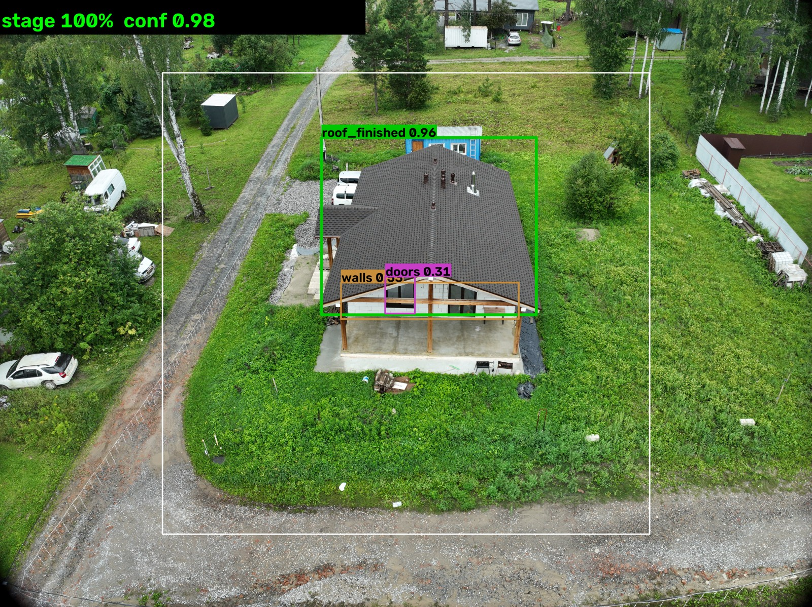
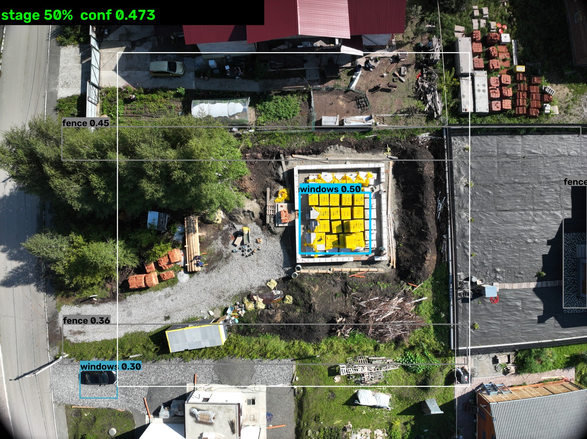

# Как проверять нейросеть: фото из интернета, метрики и честные ответы

Документ отвечает на три вопроса, которые чаще всего задают на защите:

1. Как правильно проверять работоспособность нейросети и можно ли делать это
   картинками из интернета?
2. Сможет ли модель отличить готовность дома (0 / 50 / 100 %)?
3. Что мы реально намерили на этом проекте и чего обещать нельзя.

---

## 1. Короткий ответ (TL;DR)

* **Фото из интернета — это тест на устойчивость, а не измерение точности.**
  У них нет разметки, другой ракурс, камера, сжатие, часто рендер или коллаж.
  Правильное измерение — только на **слепом размеченном наборе кадров с БПЛА**,
  где split сделан **по объектам/вылетам, а не по кадрам**.
* **Нейросеть отличает готовность дома частично.** С высоты «в надир» готовый
  дом виден в основном как **кровля**: окон и дверей сверху не видно. Поэтому
  «готовая кровля в центре кадра» — сильный признак 100 %, а «нет окон» —
  не признак 50 %. Это и было главной ошибкой исходного ноутбука.
* **Наш датасет слишком мал, чтобы говорить о точности.** 50 кадров, 2 объекта.
  Мы честно показываем цифры: модель, обученная на всех 50 кадрах, даёт 10/10
  на «валидации» — это **запоминание, а не обобщение**. Модель, обученная на
  40 кадрах и проверенная на 10 отложенных, даёт **accuracy стадии 0.40** и
  **100 % отказов** (никогда не превышает порог автопринятия). Для пилота нужны
  сотни объектов.
* **Ценность системы не в «авто-100 %», а в трёх вещах:** (а) массовая
  первичная сортировка снимков, (б) явный отказ «не вижу — к инспектору»,
  (в) доказуемый след (паспорт снимка + аудит).

---

## 2. Что именно мы имеем

| Параметр | Значение |
|---|---|
| Модель | YOLOv8n, 6 классов: `doors`, `fence`, `foundation`, `roof_finished`, `walls`, `windows` |
| Формат runtime | ONNX, инференс через `cv2.dnn` (без PyTorch), CPU |
| Обучающие данные | Roboflow-экспорт, **50 изображений 640×640**, 2 объекта (стройплощадка фундамента и готовый дом) |
| Разметка по классам | `windows` 60, `roof_finished` 50, `walls` 35, `doors` 30, `foundation` 15, `fence` 15 |
| Реальные кадры для проверки | 56 JPG с DJI M3M (5280×3956), 13 «вылетов» |
| Скорость | ≈0.45 с/кадр (полный проход + zoom) на CPU; серия из 24 кадров ≈ 11 с |

Репозиторий содержит **две** ONNX-модели, и это важно понимать:

| Файл | Как обучалась | Что показывает |
|---|---|---|
| `models/sberstroi_yolov8n.onnx` (боевая) | все 50 кадров, 20 эпох | на «валидации» 10/10 — **утечка**, эти кадры были в обучении |
| `models/sberstroi_yolov8n_holdout.onnx` | 40 кадров, 10 отложено по целым вылетам | честная оценка: accuracy стадии **0.40**, отказы **100 %** |

> Числа получены `tools/eval_model.py`, отчёты лежат в
> `models/eval_val_deployed.json` и `models/eval_val_holdout.json`.

---

## 3. Почему фото из интернета нельзя считать проверкой точности

Это называется **out-of-distribution (OOD)**. Пять причин, почему результат
такого теста ничего не говорит о качестве:

1. **Нет разметки.** Без эталона нельзя посчитать ни precision, ни recall —
   можно только посмотреть глазами и сказать «похоже/не похоже».
2. **Другой домен.** Другая камера, фокусное расстояние, высота и угол съёмки,
   сезон, освещение, JPEG-сжатие, иногда HDR, панорама или 3D-рендер.
3. **Другие объекты.** Модель обучалась на двух конкретных домах. Дом из
   интернета — это не «трудный пример», это **другой класс объектов** для неё.
4. **Нет негативов того типа, который важен банку.** Главная ошибка — принять
   соседскую кровлю за объект залога. В интернете таких кадров нет.
5. **Смещение отбора.** Легко бессознательно выбрать «красивые» фото, на
   которых модель угадывает.

**Вывод:** интернет-фото годятся для трёх вещей — (а) проверить, что система не
падает и не врёт с уверенностью на мусоре; (б) найти новые типы ошибок;
(в) собрать кандидатов в разметку. Для цифры «точность модели» — нет.

---

## 4. Как проверять правильно: протокол

### Шаг 1. Слепой размеченный набор

* Кадры с БПЛА, **оригиналы** (не пересжатые мессенджером), с EXIF/GPS.
* Разметка: стадия `0/50/100`, материал стен (если нужен), флаг «объект
  залога в кадре», дефекты (нет кровли, нет окон, разрушение).
* Размечают **два эксперта независимо**, расхождения — третий. Считать
  межэкспертное согласие (Cohen's κ): если эксперты не согласны между собой,
  модель тем более не обязана.

### Шаг 2. Split по объектам, а не по кадрам

Кадры одного вылета почти одинаковые. Если разделить их случайно, модель
проверяется на «почти тех же» снимках — это и есть утечка, из-за которой в
ноутбуке получалось `mAP50 ≈ 0.92`. Правильно: **все кадры объекта — только в
train или только в test**, и лучше — по разным регионам и сезонам.

### Шаг 3. Стратификация

Набор должен покрыть комбинации:

| Фактор | Минимум уровней |
|---|---|
| Стадия | 0 %, 50 %, 100 % (примерно поровну) |
| Материал стен | газобетон, кирпич, дерево, монолит |
| Сезон | лето (листва), зима (снег), межсезонье |
| Освещение | солнце, пасмурно, низкое солнце |
| Ракурс | надир (строго вниз), наклонный, боковой |
| Камера | хотя бы 2 модели БПЛА |

### Шаг 4. Сколько нужно объектов

Грубая оценка: чтобы измерить точность с погрешностью ±10 п.п. при 95 %
доверия, нужно ≈ **90 объектов на класс стадии**; для ±5 п.п. — ≈ **370**.
Для пилота реалистично: **100–200 объектов на стадию**, накопленных за 3–6
месяцев, + постоянный поток.

Малая выборка обманывает: 10/10 даёт 95 %-й интервал **[72 %, 100 %]**
(интервал Уилсона), а не «100 %».

### Шаг 5. Метрики, которые надо считать

| Что | Метрика | Зачем |
|---|---|---|
| Детекция | precision / recall / AP50 по каждому классу | видно, что модель реально видит |
| Стадия | матрица ошибок 3×3, accuracy | цена ошибки 50↔100 |
| **Отказы** | abstention rate + accuracy на решённых | сколько уходит людям |
| Калибровка | ECE / диаграмма надёжности | уверенность 0.9 должна означать 90 % |
| Бизнес | доля ложных «100 %» (пропуск риска) | главный риск банка |
| Скорость | сек/кадр, сек/объект | сравнение с 13 днями ручного осмотра |

### Шаг 6. Отдельно — OOD-набор

Соберите 30–50 фото «не из домена»: интернет, скриншоты, коллажи, чужие дома,
рендеры, пустые участки, зима, ночь. Ожидаемое поведение — **низкая
уверенность и отказ**, а не «уверенные 100 %». Это проверка на самонадеянность,
и её результат не смешивают с accuracy.

### Шаг 7. Мониторинг после запуска

* доля отказов по неделям (рост = drift или новые условия съёмки);
* доля ручных правок вердикта (главный сигнал деградации);
* повторная слепая проверка на «золотом наборе» раз в квартал;
* фиксация версии модели (SHA-256 ONNX) в каждом решении аудита.

---

## 5. Как это делать нашими инструментами

### Проверить одно фото или серию

```powershell
# реальный кадр
.\.venv\Scripts\python.exe tools\check_photo.py --path "..\домики\DJI_20260807144205_0005_D.JPG" --overlay out.jpg

# любое фото из интернета (скачивается с фильтром внутренних адресов)
.\.venv\Scripts\python.exe tools\check_photo.py --url "https://example.com/house.jpg"

# серия кадров одного объекта
.\.venv\Scripts\python.exe tools\check_photo.py --dir "..\домики" --json
```

### Измерить точность на своём наборе

Можно без YOLO-разметки — достаточно указать истинную стадию для каждого фото:

```csv
path,true_stage,series
photos/house_a_01.jpg,100,obj-A
photos/house_a_02.jpg,100,obj-A
photos/plot_b_01.jpg,0,obj-B
photos/foundation_c_01.jpg,50,obj-C
```

```powershell
.\.venv\Scripts\python.exe tools\eval_model.py --manifest my_test.csv --manifest-out report.json
```

Скрипт посчитает accuracy стадии, матрицу ошибок, долю отказов и точность на
тех кадрах, где модель решилась сама. Отдельно — точность по объектам (сериям),
потому что банку важно решение по объекту, а не по кадру.

### Посмотреть глазами

Streamlit → страница **«🔬 Песочница»**: загрузка файла или ссылки, источники
GPS, Quality Gate, рамки детектора, стадия и вердикт «авто / к инспектору».

---

## 6. Отличит ли модель готовность дома? (прямой ответ)

**Частично, и вот где граница.**

Что видно с высоты:

| Ракурс | Что видно | Что это значит для стадии |
|---|---|---|
| Надир (строго вниз) | кровля, иногда край стен | готовую кровлю видно хорошо, окна/двери — почти нет |
| Наклонный 30–60° | стены, окна, двери, кровля | самый информативный ракурс |
| Боковой / низкий | фасад, окна, двери | хорош для 100 %, плох для фундамента |

Поэтому в проекте принято объект-центричное правило (`photo_ai.py`):

* **100 %** — уверенная `roof_finished` **в центре кадра** (кровля = замкнутый
  контур), либо кровля + стены/окна/двери. Кровля у края кадра считается
  соседской и не даёт 100 %.
* **50 %** — стены/фундамент без готовой кровли, либо только проёмы, либо
  поддоны газобетона на площадке.
* **0 %** — ничего релевантного в центре кадра.
* **Не знаю** — низкая уверенность: уходит человеку, а не превращается в 0 %.

Что измерено на 56 реальных кадрах (13 вылетов), сравнение со старой логикой:

| Логика | Результат |
|---|---|
| Старая: решение по **первому** кадру | 4 из 13 вылетов готовых домов получили **50 %** вместо 100 % |
| Наивная: объединить классы со всех кадров | на стройплощадке дала **ложные 100 %** (нашла соседскую кровлю) |
| Новая: объект-центричное слияние | 12 из 13 вылетов — ожидаемая стадия (визуальная проверка), 1 — честное «не вижу» → к инспектору |

**Чего обещать нельзя:** «модель определит 0/50/100 на любом фото». Домены
различаются слишком сильно. **Что обещать можно:** на кадрах того же типа, что
и обучение, система уверенно отделяет готовый дом от незавершённого, а в
спорных случаях **явно отказывается** решать автоматически.

### Как выглядит результат глазами



*Готовый дом, кадр «в надир»: уверенная кровля в центре кадра → 100 %,
уверенность 0.90, авто-решение.*



*Стройплощадка с фундаментом и поддонами газобетона: стадия 50 %, уверенность
0.47 → **отказ от автоматического решения**, к инспектору. Белая рамка — зона
«объект интереса».*

### Важное ограничение, которое мы нашли на реальных данных

В архиве подрядчика попались **наземные** снимки (снятые с земли, не с БПЛА) —
например, фото недостроенного дома с улицы. Модель на них **не работает**:
она обучалась только на аэроснимках «в надир» и видит там «забор» вместо
стен и окон. Это нормальное поведение модели вне домена, и именно поэтому в
системе есть явный отказ и требование «кадр с БПЛА по полётному заданию», а не
«любая фотография дома».

Практический вывод: перед подачей в модель нужен **фильтр типа съёмки**
(наличие EXIF БПЛА, высота, угол), иначе наземные фото будут давать
систематически заниженную стадию.


---

## 7. Что улучшит качество (по убыванию эффекта)

1. **Данные.** 300–500 кадров, 50+ объектов, разные регионы/сезоны. Это даёт
   больше, чем любая смена архитектуры.
2. **Класс `roof_frame`** (каркас кровли, без покрытия) — он был в ноутбуке,
   но потерялся в экспорте. Без него «каркас» и «готовая кровля» неразличимы,
   а это ровно граница 50 ↔ 100 %.
3. **Отдельный классификатор «кровля готова / не готова»** на кропе вокруг
   центральной кровли: детектор отвечает «где», классификатор — «закрыт ли
   контур». Дешёво и сильно точнее на границе.
4. **Разметка отказов.** Всё, что ушло инспектору, размечать и дообучать —
   активное обучение прямо на слабых местах.
5. **Калибровка температуры** на отложенном наборе — чтобы 0.75 в интерфейсе
   означало реальные 75 %.
6. **Определение материала стен** — сейчас всегда `unknown`, а для оценки
   стоимости банку это нужно.

---

## 8. Чек-лист перед защитой

- [ ] Показать `tools/check_photo.py` на реальном кадре и на фото из интернета.
- [ ] Показать страницу «Песочница»: GPS-источник, отказ, рамки.
- [ ] Назвать честные цифры: 10/10 на утечке ≠ точность; holdout 0.40.
- [ ] Объяснить, почему крыша = 100 %, а отсутствие окон не = 50 %.
- [ ] Показать, что при неуверенности система **отказывается** решать.
- [ ] Сказать, что нужно для пилота: 100–200 объектов на стадию и слепой тест.
