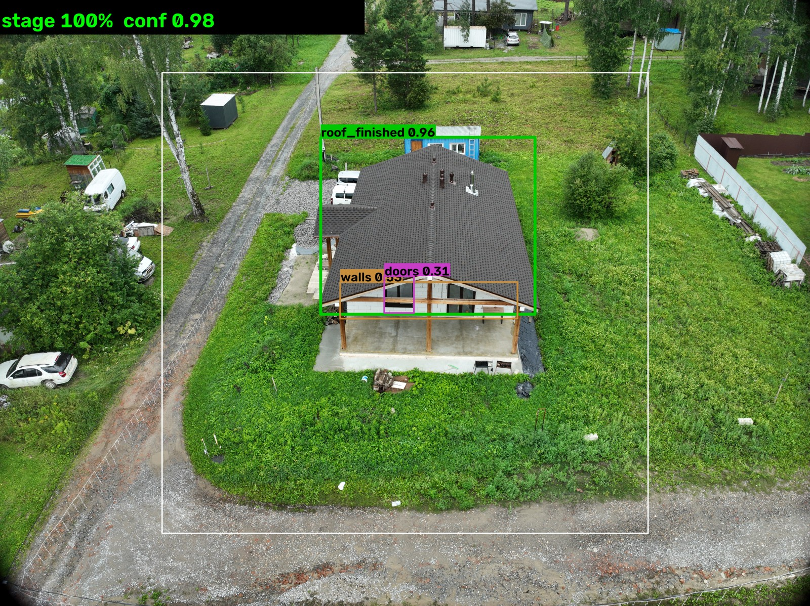

# СтройКонтур — AI-мониторинг объектов ИЖС

Прототип для хакатона Sber: по аэрофотоснимкам с дрона система определяет стадию
строительства частного дома (**0 / 50 / 100 %**), проверяет подлинность снимка и
выбирает одну из **8 кредитных стратегий** для залогового отдела.



## Что внутри

Три слоя:

1. **«Глаз»** — EXIF/GPS, контроль качества кадра, QR-маркер полётного задания,
   нейросеть YOLOv8n (ONNX) по серии кадров.
2. **«AI-Дирижёр»** — правила выбора стратегии из 8 и объяснение решения.
3. **Безопасность** — SHA-256 файла, паспорт снимка, уровни доказанности,
   журнал аудита с цепочкой хэшей, безопасная загрузка по ссылке (защита от SSRF).

## Быстрый старт

```bat
run.bat
```

Скрипт сам создаст недостающее, найдёт свободный порт, откроет браузер и будет
слушать только `127.0.0.1`. Если окружение не создано — см.
[`PythonProject/README.md`](PythonProject/README.md).

## Демо-данные

| Файл | Что показывает |
|---|---|
| `PythonProject/demo_data/demo_object_1_ok.jpg` | стройплощадка, стадия 50 % |
| `PythonProject/demo_data/demo_object_2_ok.jpg` | готовый дом, стадия 100 % |
| `PythonProject/demo_data/demo_fraud_no_exif.jpg` | нет метаданных → риск фрода |

## Документация

* [Простыми словами](PythonProject/docs/HOW_IT_WORKS_SIMPLE.md) — как всё устроено, для человека без опыта.
* [Разбор интерфейса](PythonProject/docs/UI_GUIDE.md) — каждая плашка и откуда цифры.
* [Безопасность](PythonProject/docs/SECURITY_REPORT.md) — откуда GPS, что защищено, что нет.
* [Валидация нейросети](PythonProject/docs/AI_VALIDATION.md) — честные метрики и протокол проверки.
* [QR-маркер полётного задания](PythonProject/docs/QR_MARKER_DESIGN.md) — как должно работать.
* [Протокол съёмки](PythonProject/docs/SURVEY_PROTOCOL.md) — высоты, перекрытие, GSD, JSON задания.
* [Экономика](PythonProject/docs/ECONOMICS.md) — расчёт трудозатрат.
* [Что изменено](PythonProject/docs/CHANGELOG.md) — история решений.

## Проверка любого фото

```powershell
cd PythonProject
.\.venv\Scripts\python.exe tools\check_photo.py --path "C:\photos\house.jpg" --overlay out.jpg
.\.venv\Scripts\python.exe tools\check_photo.py --url "https://example.com/photo.jpg"
```

## Тесты

```powershell
cd PythonProject
.\.venv\Scripts\python.exe -m unittest discover -s tests
```

## Честно об ограничениях

* Модель обучена на **50 снимках двух объектов** — промышленную точность не
  обещаем. Честная оценка на отложенной выборке: точность стадии **0.40**.
* Материал стен не определяется (всегда `unknown`).
* Нет аутентификации и ролей; журнал не защищён от удаления целиком (нужен WORM).
* Интеграции с АС «Калита» нет — выгрузка акта демонстрационная.
* Дрон не подписывает снимки — доказательность строится на QR-маркере
  полётного задания, хэше файла и журнале.

## Лицензия и данные

Учебный прототип. Реальные снимки объектов, персональные данные клиентов и
исходный архив дрона (`домики/`, 521 МБ) в репозиторий не включены.
